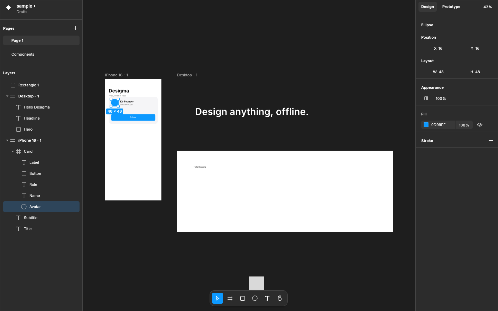

# desigma

A free, offline Figma alternative written in Rust. The goal is a pixel-faithful
recreation of Figma's editor that runs entirely on your machine, with no account
and no cloud.



## Status

Early scaffold. It already does:

- An infinite canvas rendered on the GPU with [vello](https://github.com/linebender/vello),
  with pan (scroll, Space+drag, middle mouse, Hand tool) and zoom (Ctrl/Cmd+scroll, pinch).
- Frames, rectangles, ellipses, text and groups. Frames clip their content, and
  layers drawn or dropped onto a frame become its children.
- Selection by click, Shift+click, marquee and Ctrl/Cmd deep select. Double-click
  enters a group or edits text. Layers can be moved with snapping guides and
  resized with handles (Shift keeps the aspect ratio).
- Text editing directly on the canvas, using the bundled Inter font.
- A layers panel (show/hide, lock, rename, drag to reorder), pages, and a
  Design panel (position, size, opacity, corner radius, typography, fills, strokes).
- Undo/redo, copy/paste (including plain text, which becomes a text layer),
  duplicate, group/ungroup, and layer order.
- `.desigma` files: versioned JSON, written atomically.

## Layout

| Path | What |
| --- | --- |
| `crates/desigma-core` | Document model, editing operations, undo history, file format. No GPU/UI deps. |
| `crates/desigma-render` | Builds a vello scene from a page; text layout. |
| `apps/desigma` | The desktop app (eframe/egui + wgpu). |
| `assets/fonts` | Inter (SIL OFL 1.1). |

## Build and run

```sh
cargo run --release -p desigma -- [file.desigma]
cargo test --workspace
```

On Linux the app loads X11/Wayland libraries at runtime (`libxkbcommon-x11`, `libxcursor`, and others).

## Shortcuts

| Key | Action |
| --- | --- |
| V / H / F (A) / R / O / T | Move, Hand, Frame, Rectangle, Ellipse, Text |
| Ctrl+Z / Ctrl+Shift+Z | Undo / Redo |
| Ctrl+C / Ctrl+X / Ctrl+V / Ctrl+D | Copy / Cut / Paste / Duplicate |
| Ctrl+G / Ctrl+Shift+G | Group / Ungroup |
| Delete, Backspace | Delete |
| Arrows (Shift for 10px) | Nudge |
| `]` `[` (Ctrl for front/back) | Bring forward / Send backward |
| Enter / Shift+Enter, Esc | Select children / Select parent |
| Shift+0 / Shift+1 / Shift+2 | Zoom 100% / Zoom to fit / Zoom to selection |
| Ctrl+S / Ctrl+Shift+S / Ctrl+O / Ctrl+N | Save / Save as / Open / New |

## License

MIT OR Apache-2.0. Inter is under the SIL Open Font License; see `assets/fonts/Inter-LICENSE.txt`.
