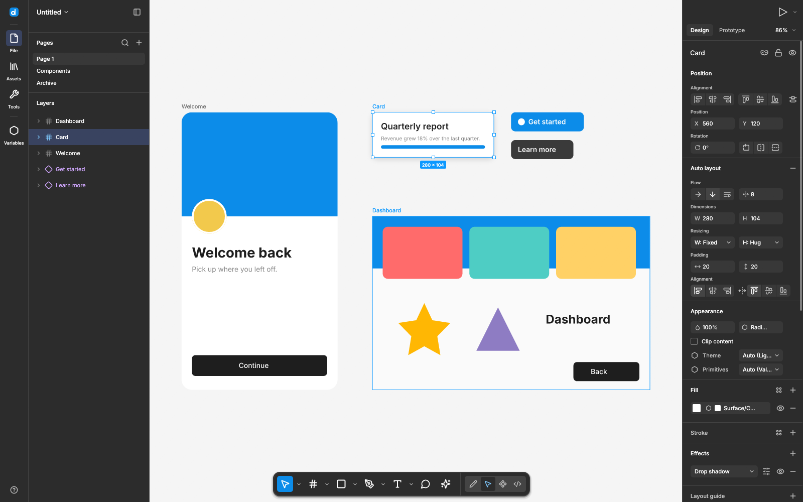
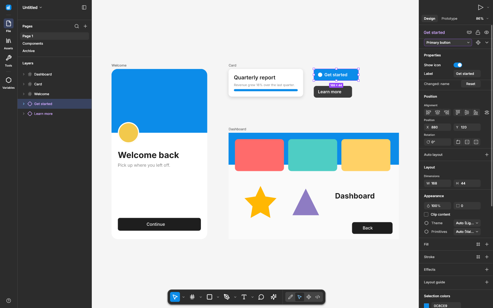
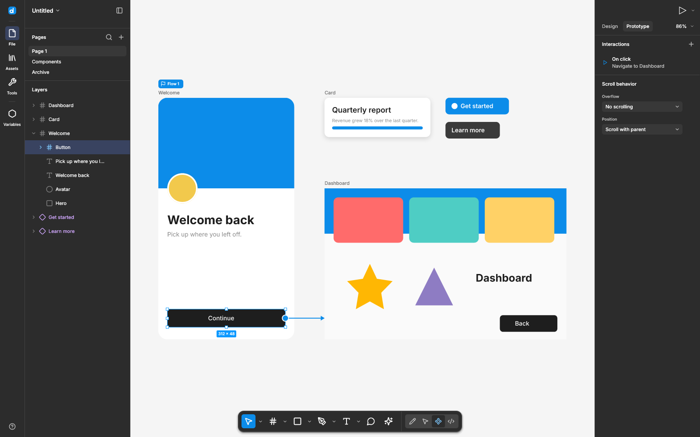
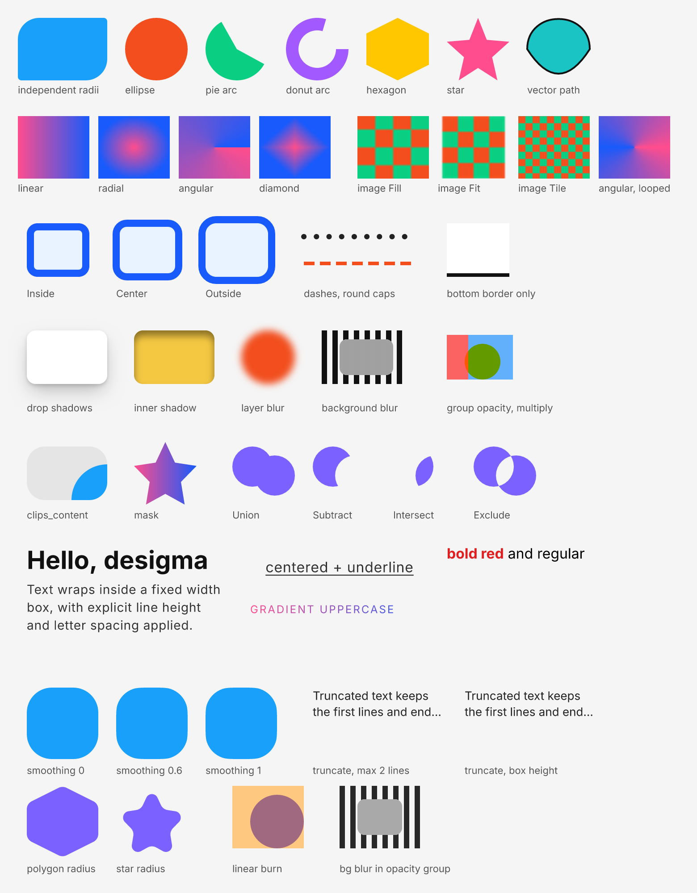
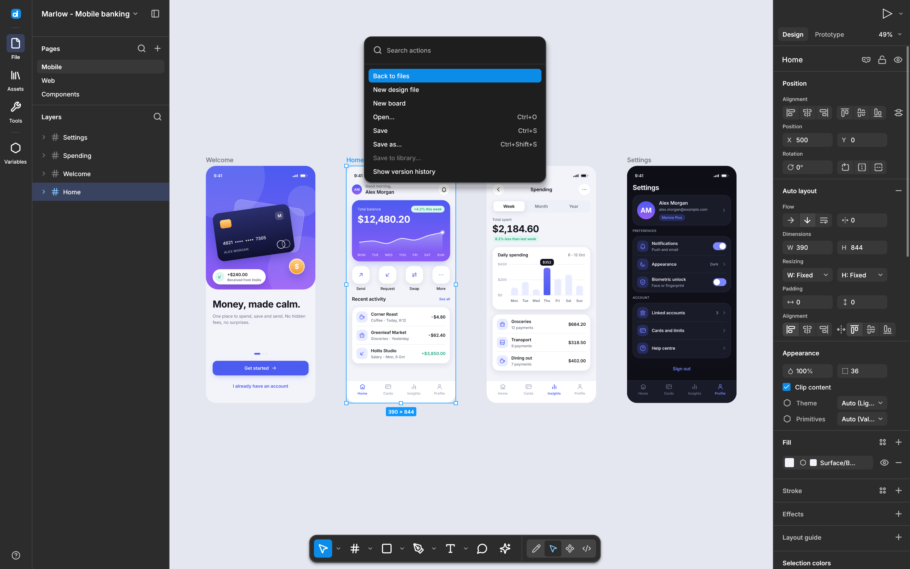

<p align="center">
  
</p>

<h1 align="center">desigma</h1>

<p align="center">
  <b>Interface design; a free, open-source design tool in the spirit of Figma, rebuilt in pure Rust.</b><br>
  Frames, auto layout, components and variants, prototyping, vector editing and real Figma file import,<br>
  in a native desktop app written entirely in Rust. Free, offline, and yours to change.
</p>

<p align="center">
  
  
  
  
  <a href="https://github.com/deepfounder-ai/desigma/actions/workflows/ci.yml"></a>
</p>

<br>

<p align="center">
  
  <br>
  <sub>The editor with the demo document: frames, a card with a drop shadow, button instances and the Design inspector.</sub>
</p>

<br>

<table>
  <tr>
    <td width="25%" valign="top">
      <h3>🎛️ Familiar by design</h3>
      The panels, toolbar, menus and shortcuts sit where Figma users expect them, from <kbd>F</kbd> for Frame to <kbd>Shift</kbd>+<kbd>A</kbd> for auto layout. The chrome is measured against the real thing and checked with a pixel-diff harness.
    </td>
    <td width="25%" valign="top">
      <h3>⚡ Native and fast</h3>
      A deterministic CPU renderer on tiny-skia, a spatial index and a parallel 256&nbsp;px tile cache. Panning and dragging on a 5,000-layer page stay well under a frame. No Electron, no web view.
    </td>
    <td width="25%" valign="top">
      <h3>🗂️ Figma files in</h3>
      Import from the Figma REST API JSON or straight from <code>.fig</code> files (the kiwi container, deflate or zstd), with components, instance overrides, styles and prototype links.
    </td>
    <td width="25%" valign="top">
      <h3>🔤 Open fonts, built in</h3>
      Inter ships inside the binary. Any other open-licensed family a file uses is fetched from Fontsource and cached, and proprietary fonts map to metric-compatible open alternatives.
    </td>
  </tr>
</table>

<br>

## Features

Every screenshot here is the real app, captured offscreen with its own <code>--screenshot</code> mode.

<table>
  <tr>
    <td width="50%" valign="top">
      
      <br>
      <sub>An instance selected: component properties, overrides and the swap picker.</sub>
      <h3>Components that stay in sync</h3>
      Turn any layer into a component with <kbd>Ctrl</kbd>+<kbd>Alt</kbd>+<kbd>K</kbd>, drop instances from the Assets panel, and edit the main component: every instance updates in the same undo step while keeping its own overrides.
      <br><br>
      <b>Boolean, text, variant and instance-swap properties</b>, Combine as variants, Go to main component, Reset all changes and Detach, all undoable.
    </td>
    <td width="50%" valign="top">
      
      <br>
      <sub>Prototype mode: a flow flag, a hotspot and a connector to the destination frame.</sub>
      <h3>Prototype what you draw</h3>
      Drag from a layer's hotspot to a frame to wire it up, then refine the interaction: triggers, actions, overlays and transitions with easing curves and springs.
      <br><br>
      <b>Present</b> plays it back with Navigate, Back, overlays, Change to (variants), Scroll to and Smart Animate, which pairs layers by name and interpolates them.
    </td>
  </tr>
  <tr>
    <td width="50%" valign="top">
      
      <br>
      <sub>The renderer's feature sheet, produced by <code>cargo run -p desigma-render --example render_demo</code>.</sub>
      <h3>A renderer that sweats the pixels</h3>
      Independent corner radii and iOS-style corner smoothing, every gradient type, image fills, inside, center and outside strokes, drop and inner shadows, layer and background blur, masks and boolean operations.
      <br><br>
      <b>All 19 blend modes</b>, including exact linear burn and linear dodge, and text shaped with cosmic-text, with runs, line height, letter spacing, case and truncation.
    </td>
    <td width="50%" valign="top">
      
      <br>
      <sub>Actions (<kbd>Ctrl</kbd>+<kbd>K</kbd>): every command, searchable, with its shortcut.</sub>
      <h3>Everything a keystroke away</h3>
      The main menu, tool dropdowns, context menus and the command palette all share one menu widget built to Figma's measured spacing, with full keyboard navigation and submenus.
      <br><br>
      <b>Export</b> to PNG, JPG and real vector SVG at any scale, copy as PNG, SVG or CSS, and switch to Dev mode for measurements and ready-to-paste CSS.
    </td>
  </tr>
</table>

<br>

## Everything in the box

<table>
  <tr>
    <td width="33%" valign="top">
      <h4>🧰 Tools</h4>
      Move · Hand · Frame · Section · Slice · Rectangle · Line · Arrow · Ellipse · Polygon · Star · Image · Pen · Pencil · Text, with snapping, smart guides and distance labels, multi-select, rotate, alt-drag duplicate and vector point editing.
    </td>
    <td width="33%" valign="top">
      <h4>📐 Layout</h4>
      Auto layout with direction, wrap, gap, padding, alignment and hug, fill or fixed sizing, plus drag to reorder. Constraints, groups, clipping frames, and pages you can add, duplicate, reorder and delete.
    </td>
    <td width="33%" valign="top">
      <h4>🎨 Styles and color</h4>
      Shared color, text and effect styles with names, folders and keys, applied in one click. A Selection colors section that edits every use of a color at once.
    </td>
  </tr>
  <tr>
    <td width="33%" valign="top">
      <h4>🗂️ Formats</h4>
      In: <code>.fig</code>, Figma REST JSON and native <code>.desigma</code>. Out: <code>.desigma</code>, Figma REST JSON, PNG, JPG and SVG. Images in PNG, JPEG and WebP.
    </td>
    <td width="33%" valign="top">
      <h4>🔤 Type</h4>
      Bundled Inter variable font, per-run styles, line height in pixels or percent, letter and paragraph spacing, case transforms, decorations, auto-resize and truncation with an ellipsis.
    </td>
    <td width="33%" valign="top">
      <h4>🪄 The everyday essentials</h4>
      Undo and redo for every edit, copy and paste, group and ungroup, align and distribute, z-order, flip and rotate 90°, and zoom to fit or 100%.
    </td>
  </tr>
</table>

<br>

## Figma files

desigma reads two kinds of Figma input, and both land in the same document model:

- **REST JSON**, the body of `GET /v1/files/:key`. Save it to a file and open it, or let the optional `net` feature of `desigma-fig` fetch it with your personal access token. The token is only ever sent as a request header and is never logged or stored.
- **`.fig` files**, from *File → Save local copy*. desigma unpacks the zip wrapper, decodes the kiwi schema and message, and maps node changes, embedded images, shared styles, instance overrides, layout grids and prototype interactions.

The `.fig` format is undocumented. Our decoder follows community reverse engineering and is tested against synthetic files, so expect gaps on real-world files and please report them.

## Under the hood

- **One document model:** `desigma-doc` is plain data plus an undo stack. Every edit is a `Command` with an exact inverse.
- **Deterministic rendering:** `desigma-render` draws on the CPU with tiny-skia, so output is reproducible byte for byte. Tiles stitched together match a whole-page render.
- **Pixel-checked chrome:** `desigma-diff` compares the app's screenshots against reference captures with anti-aliasing detection and SSIM, and writes an HTML report.
- **Clean-room:** built from public documentation and observed behavior. No Figma code, icons or assets; the icons are our own.
- **Tested:** more than 500 tests across the workspace, from undo and import round trips to UI tests that drive the editor with synthetic input.

| Crate | What it does |
|---|---|
| `desigma-doc` | Scene graph, paints, text, auto layout, components, prototype model, undo/redo |
| `desigma-render` | tiny-skia renderer, spatial index, parallel tile cache |
| `desigma-fig` | Figma REST JSON and `.fig` import, REST JSON export |
| `desigma-fonts` | Bundled Inter, Fontsource fetch and cache, font substitution |
| `desigma-export` | PNG, JPG and SVG export, Dev mode CSS |
| `desigma-app` | The egui desktop editor |
| `desigma-diff` | Pixel-diff library and CLI |

## Get started

```sh
git clone https://github.com/deepfounder-ai/desigma
cd desigma
cargo run --release -p desigma-app               # the editor, with a demo document
cargo run --release -p desigma-app -- file.fig   # open a Figma file
cargo test --workspace                           # the test suite
```

On Linux you need the usual windowing headers: `pkg-config libxkbcommon-dev libwayland-dev libx11-dev libxcursor-dev libxrandr-dev libxi-dev libgl1-mesa-dev libfontconfig1-dev`. macOS is built and tested in CI.

Want to contribute or cut a release? See [CONTRIBUTING.md](CONTRIBUTING.md) and [docs/releasing.md](docs/releasing.md).

Useful flags for automation and testing:

```sh
desigma --screenshot out.png --size 1600x1000 --select Card   # render one frame and exit
desigma --select Welcome --rulers --layout-grid columns --zoom 120 --screenshot out.png   # rulers + column grid
desigma --edit-text "Welcome back" --select-text 0-7 --screenshot out.png                 # mid-edit with a selection
desigma --tab prototype --present                              # open straight into Present
desigma-diff compare reference.png actual.png --out diff.png   # pixel-compare two images
```

> [!IMPORTANT]
> **Status:** desigma is in early alpha. Much of Figma's everyday design surface exists, but **it is not yet a replacement for professional daily work**. The biggest gaps are real-world `.fig` coverage, collaboration and comments, plugins, variables, PDF export, and GPU rendering for very large files. Expect rough edges, and please file issues with your OS, a sample file if you can share one, and a screenshot.

## License

Licensed under either of [MIT](LICENSE-MIT) or [Apache-2.0](LICENSE-APACHE), at your option. Unless you state otherwise, any contribution you submit for inclusion is dual-licensed the same way, without additional terms.

Bundled Inter is © The Inter Project Authors, licensed under the SIL Open Font License 1.1 (see `crates/desigma-fonts/assets/inter/OFL.txt`).

desigma is an independent project. It is not affiliated with, endorsed by or sponsored by Figma, Inc. Figma is a trademark of Figma, Inc., used here only to describe file compatibility.
